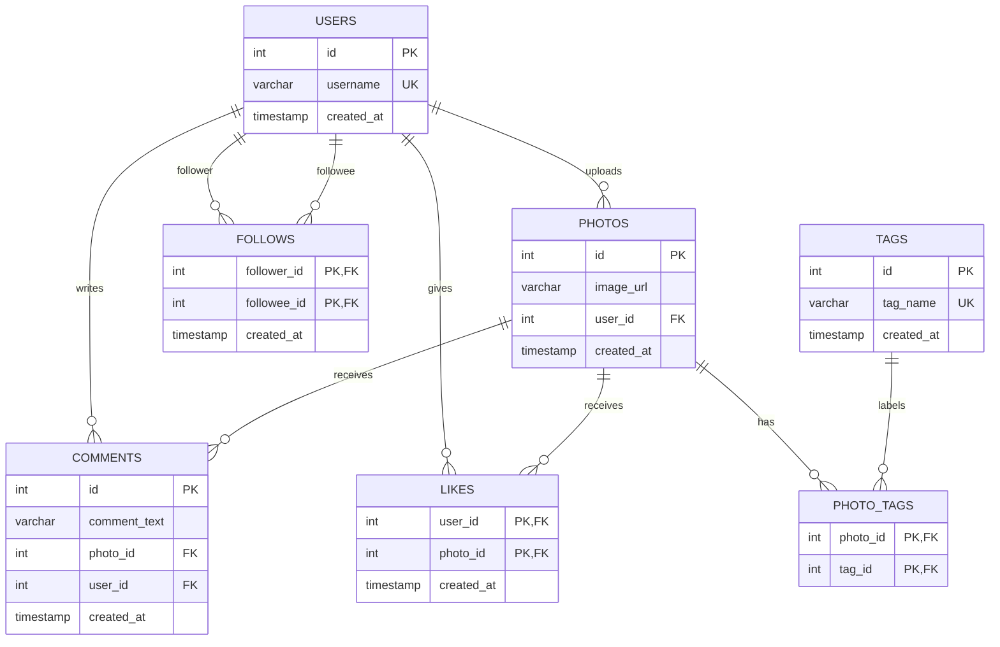

# Instagram Clone – SQL Database & Data Analysis

> A relational database project that recreates the core data structure of an Instagram-style social platform and uses MySQL queries to explore user activity, photo engagement, follows, comments, and hashtags.

**Recommended GitHub repository name:** `instagram-clone-sql-analysis`

---

## Project Overview

This project builds an Instagram-inspired relational database using **MySQL**. It models the relationships between users and the content they create or interact with, then applies SQL queries to answer practical data-analysis questions.

The project is focused on **database design and SQL analysis**. It is not a front-end Instagram application and does not include a web interface, authentication system, or application API.

### Project objectives

- Design a normalized relational database with primary and foreign keys.
- Model one-to-many, many-to-many, and self-referencing relationships.
- Load sample records into the database.
- Retrieve and filter records using `SELECT`, `WHERE`, `LIKE`, `ORDER BY`, and `LIMIT`.
- Analyse photo uploads, likes, comments, follows, and hashtag usage.
- Practise joins, aggregate functions, grouping, subqueries, and `HAVING`.

## Technology Stack

| Technology | Purpose |
|---|---|
| MySQL | Relational database and query execution |
| SQL | Schema creation, data insertion, and analysis |
| MySQL Workbench (recommended) | Database management and query development |
| Mermaid ER diagram | Visual representation of database relationships |

---

## Database Schema

The database is named `ig_clone` and contains **seven tables**:

| Table | Purpose |
|---|---|
| `users` | Stores user accounts and registration timestamps |
| `photos` | Stores photo URLs, uploaders, and upload timestamps |
| `comments` | Stores comments made by users on photos |
| `likes` | Records which users like which photos |
| `follows` | Records follower/followee relationships between users |
| `tags` | Stores unique hashtag names |
| `photo_tags` | Connects photos with their associated tags |

### Entity Relationship Diagram

The diagram below represents the tables and their key relationships.



### Relationship Summary

- **Users → Photos:** One user can upload many photos; each photo belongs to one user.
- **Users → Comments:** One user can write many comments; each comment is written by one user.
- **Photos → Comments:** One photo can receive many comments.
- **Users ↔ Photos through Likes:** Users can like multiple photos, and photos can receive likes from multiple users. The composite primary key `(user_id, photo_id)` prevents the same user from liking the same photo more than once.
- **Users ↔ Users through Follows:** A user can follow many users and can be followed by many users. `follower_id` and `followee_id` both reference `users.id`.
- **Photos ↔ Tags through Photo_Tags:** A photo can have multiple tags, and a tag can be used on multiple photos. The composite primary key `(photo_id, tag_id)` prevents duplicate tag assignments for the same photo.

### Key Design Decisions

- Auto-incrementing integer primary keys identify users, photos, comments, and tags.
- `users.username` and `tags.tag_name` are unique.
- Foreign keys maintain referential integrity between related records.
- Composite primary keys are used in `likes`, `follows`, and `photo_tags`.
- Timestamp columns record when users register and when platform activities occur.

---

## SQL Concepts Practised

The project includes examples and exercises using the following SQL concepts:

| SQL concept | How it is used |
|---|---|
| `CREATE DATABASE`, `CREATE TABLE` | Build the database and its tables |
| `INSERT INTO` | Load sample users and activity records |
| `SELECT` | Retrieve all or selected columns |
| `WHERE` | Filter users and records |
| `LIKE` | Search usernames using text patterns |
| `ORDER BY`, `LIMIT` | Sort results and return top records |
| `COUNT()` | Count users, photos, likes, and tag usage |
| `GROUP BY` | Aggregate activity by user, photo, or tag |
| `INNER JOIN` | Combine related records |
| `LEFT JOIN` | Find records with no matching activity |
| `HAVING` | Filter grouped results |
| Subqueries | Compare aggregates with totals |
| `DAYNAME()` | Analyse registrations by weekday |

---

## Analysis Questions Covered

The analysis section of the SQL script explores questions such as:

### 1. User Registration Analysis
- How many users are registered?
- Which users registered after 1 January 2017?
- Which users registered most recently?
- Who are the five oldest registered users?
- On which weekdays were the most users registered?

### 2. Photo Upload Analysis
- How many photos are stored?
- How many photos has each user uploaded?
- Which five or ten users uploaded the most photos?
- Which users have never uploaded a photo?
- What is the average number of photos per registered user?

### 3. Engagement Analysis
- How many likes has each photo received?
- Which ten photos have the most likes?
- Which single photo has the highest number of likes?
- Which users have liked every photo in the database?

### 4. Hashtag Analysis
- Which ten tags are associated with the most photos?
- Which five hashtags are most commonly used?

These questions demonstrate how relational data can be joined and aggregated to derive useful platform engagement insights.

---

## Getting Started

### Prerequisites

- MySQL Server 8.0 or a compatible MySQL version.
- MySQL Workbench or another MySQL client.
- Basic familiarity with running SQL scripts.

### Installation and Setup

**1. Clone the repository**

```bash
git clone https://github.com/YOUR-GITHUB-USERNAME/instagram-clone-sql-analysis.git
```

**2. Open the project**

Open the SQL script in MySQL Workbench.

**3. Execute the script**

Run the script to:
1. Create the `ig_clone` database.
2. Create all seven tables.
3. Insert the sample data.
4. Execute the practice and analysis queries.

**4. Select the database**

If running queries separately, execute:

```sql
USE ig_clone;
```

**5. Explore the tables**

```sql
SHOW TABLES;

SELECT * FROM users;
SELECT * FROM photos;
SELECT * FROM comments;
SELECT * FROM likes;
SELECT * FROM follows;
SELECT * FROM tags;
SELECT * FROM photo_tags;
```

> **Important:** The supplied setup script begins with `DROP DATABASE IF EXISTS ig_clone;`. This deletes an existing database named `ig_clone` before recreating it. Back up any data you need before running the complete script. If you do not want to reset the database, remove or comment out that statement and run only the required sections.

---

## Suggested Repository Structure

For a clean and maintainable GitHub repository, organise the files like this:

```text
instagram-clone-sql-analysis/
│
├── README.md
│
├── sql/
│   └── instagram_clone.sql
│
└── diagrams/
    └── er-diagram.md
```

The SQL file should contain the database creation, table definitions, sample data, and analysis queries. The ER diagram is also documented in this README, so the separate diagram file is optional.

---

## Notes and Possible Improvements

The current project is a SQL learning and analysis project. The following are possible next steps, not features already implemented:

- Add indexes to frequently queried foreign-key and filter columns, then compare query performance with `EXPLAIN`.
- Add validation constraints, such as preventing a user from following themselves.
- Add `ON DELETE` behaviour where appropriate and document the chosen data-retention rules.
- Add queries for comment counts, follower counts, and following counts.
- Create SQL views for frequently used engagement summaries.
- Add a separate insights document with screenshots of query outputs and explanations.
- Add a data dictionary describing each column and its business meaning.

### Query review before publishing

A couple of details are worth checking as you polish the SQL script:

- The comment says “usernames contain the letter a”, but the current pattern `LIKE 'a%'` finds usernames that **start** with `a`. To find the letter `a` anywhere in a username, use `LIKE '%a%'`.
- The “users who have liked every single photo” query compares each user's like count with the total number of photos. This is appropriate when each user-photo pair can appear only once (which the `likes` composite primary key enforces). It assumes the analysis is against the complete photo set.

---

## Learning Outcomes

By completing this project, I practised:

- Translating a real-world social-media use case into a relational schema.
- Identifying primary keys, foreign keys, and composite keys.
- Understanding one-to-many, many-to-many, and self-referencing relationships.
- Writing SQL queries to retrieve, filter, join, and aggregate data.
- Using grouped analysis to identify upload and engagement patterns.
- Structuring a SQL project for version control and portfolio presentation.

---

## Author

**Rahul Yadav**

Aspiring Data Analyst | SQL & Database Analysis

This project is part of my ongoing journey in developing practical data analytics and database-management skills.

---

*If you find this project useful, feel free to explore the SQL script and adapt the analysis queries for your own practice.*
